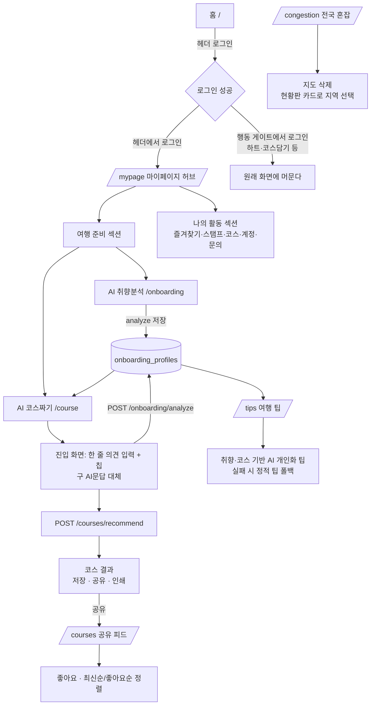

# 08 — 기능확장 PRD 애드온 (2026-08-20) · 마이페이지 허브 통합 + 기능 정리 6건

- **문서 성격**: 기존 계약(`01-interface-contract.md` 부록 A~Y)을 **대체하지 않는 애드온**. 여기서 확정한 것만 부록으로 additive 추가한다.
- **작성**: planning-lead / **일자**: 2026-08-20
- **선행 문서**: `인수인계 8월 10일.md`(현 인프라·함정), `01-interface-contract.md`(부록 B 온보딩 · I 코스 · N 컨시어지 · R 공유/리뷰 · U~Y), `02-roadmap.md`(MVP-3~7), `STATUS.md`, `APPROVALS.md`
- **직전 작업과의 접점**: 2026-08-18 보안감사 A-6 반영(커밋 `6a7ed86`+`f74cdcb`) — 공유 코스 payload 재구성(`course_payload.rebuild_course_for_store` / `filter_stored_course`). **이 PRD의 5번 항목은 그 위에 얹는다. 재구성 로직을 건드리면 안 된다.**

---

## 0. 30초 요약

대표 지시 6건은 낱개 기능이 아니라 **하나의 동선 재편**이다.

```
[지금]  홈 ─ GNB 8메뉴 ─ /onboarding · /course · /ask · /congestion · /courses 가 전부 평면 배치
        로그인해도 진입점이 바뀌지 않는다. 마이페이지는 "계정관리+문의" 서랍에 가깝다.

[목표]  로그인 → 마이페이지가 허브가 되고, 그 안에서 취향분석·AI 코스짜기를 시작한다.
        자유 문답(/ask)은 없애고 그 역할을 "코스짜기 진입 화면의 한 줄 의견 입력"으로 흡수한다.
        혼잡 "지도"는 지우되 혼잡도 데이터·배지·현황판은 전부 남긴다.
        공유 코스 피드에 좋아요·정렬이 붙고, 여행 팁이 취향/코스에 맞춰 생성된다.
```

**핵심 판단 3가지 (조사 결과)**

1. **6번은 신설이 거의 없다.** "짧게 의견을 듣는 입력"은 이미 `POST /api/v1/onboarding/analyze`(`text` 자유텍스트 + `chips`)가 하는 일이다. 새 API를 만들지 말고 **그 입력창을 `/course` 진입 화면에 재배치**하고 `/ask`(컨시어지)를 제거한다.
2. **1번의 위험은 라우트가 아니라 리다이렉트다.** `/onboarding`·`/course` 라우트를 옮기면 GNB·퀵메뉴·푸터·팁 가이드·`/regions` CTA 등 **12곳 이상의 내부 링크와 딥링크(`?region_code=`)가 깨진다.** 라우트는 그대로 두고 **진입 동선(로그인 후 착지점 + 마이페이지 타일)만** 바꾼다.
3. **3번·6번은 기능을 줄이는 결정이다.** 혼잡 지도는 지정과제 2번("쏠림 완화")의 시각적 근거였고, AI 문답은 `APPROVALS.md`에 "차별화 2호(구석구석에 없는 대화형 AI)"로 기록돼 있다. 대표 지시대로 진행하되 **공모전 심사 관점의 손실을 §8에 정직하게 남긴다**(뒤집을 근거가 필요할 때 여기를 본다).

---

## 1. 문제 정의

| # | 문제 | 근거(실제 코드) |
|---|---|---|
| P-1 | 로그인해도 사용자가 갈 곳이 안 바뀐다. 로그인은 "기능 잠금 해제"일 뿐 개인화된 출발점이 없다 | `Header.tsx` 로그인 성공 콜백이 `onLoggedIn={() => {}}` — 화면 전환 없음. 마이페이지는 GNB에 없고 `{닉네임}님` 링크로만 닿는다 |
| P-2 | AI 기능 3개(취향분석·코스짜기·문답)가 서로 다른 메뉴에 흩어져 있고 문답은 코스짜기와 결과가 겹친다 | GNB "AI 여행 경로" 드롭다운에 `/course`·`/ask`·`/courses`가 나란히 있고, `/ask` 응답도 결국 스팟 목록 + 코스 CTA(`AskContent.tsx` 319행) |
| P-3 | 혼잡 지도가 화면 면적을 크게 쓰는데 정보량은 아래 현황판과 중복이다 | `/congestion` = `KoreaSvgMap`(좌) + 랜드마크 패널(우) + `CongestionBoard`/`NationwideBoard`(아래) + `DeparturePlanner` |
| P-4 | 여행 팁이 5개 고정 문구다 — 누가 봐도 같은 화면 | `frontend/content/travel-tips.ko.json`(정적 5건, `version: 2`), `02-roadmap.md` MVP-7 파트3에 "문구는 placeholder" 명시 |
| P-5 | 공유 코스 피드에 반응 수단이 없어 좋은 코스가 묻힌다. 정렬도 최신순 고정 | `shared_course_repo.list_shares` — `ORDER BY created_at DESC, seq DESC` 하드코딩. `06-deep-audit-gap-plan.md`에서 "좋아요·조회수 = 흡수 불가"로 분류했던 항목 |
| P-6 | 현재 어떤 AI 모델·프롬프트를 쓰는지 한 장으로 정리된 문서가 없다 | 모델 설정은 `backend/app/config.py` 80~143행에 흩어져 있고, 전략 문서 `design-docs/02-ai-strategy.md`는 구현 이전 시점 문서다 |

---

## 2. 목표 (성공 기준)

| # | 목표 | 측정 가능한 완료 조건 |
|---|---|---|
| G-1 | 로그인한 사용자의 출발점이 마이페이지다 | 헤더 로그인 버튼으로 로그인 → `/mypage` 착지. **단, 로그인 게이트(행동 도중 로그인)에서는 원래 자리에 머문다** |
| G-2 | 마이페이지에서 온보딩·AI 코스짜기를 시작할 수 있다 | `/mypage`에 "AI 취향분석"·"AI 코스짜기" 진입 타일이 있고, 취향 완료 여부가 표시된다(`GET /api/v1/onboarding/me` 재사용) |
| G-3 | 자유 문답 인터페이스가 사라지고 코스짜기 안에서 의견을 말할 수 있다 | `/ask` 404 아님(§4-6 처리 방식 참조), GNB·홈에서 문답 진입점 0개, `/course` AI 모드 상단에 한 줄 의견 입력 존재. `/api/v1/concierge/*` 라우터 미등록 |
| G-4 | 혼잡 지도가 화면에서 사라지되 혼잡도 정보는 그대로다 | `KoreaSvgMap` 렌더 0곳. `GET /congestion/board`·`/nationwide`·`/forecast` 및 스팟 카드 혼잡 배지·`visit_tip` 전부 무회귀 |
| G-5 | 여행 팁이 사용자마다 달라진다 | 취향 프로필이 있는 두 계정이 `/tips`에서 서로 다른 팁을 본다. LLM 실패 시 기존 정적 5건으로 폴백(화면이 비지 않는다) |
| G-6 | 공유 코스에 좋아요와 정렬이 있다 | 피드에서 좋아요 토글 가능(계정당 1회), "좋아요순/최신순" 전환 시 순서가 실제로 바뀜, 재접속해도 내가 누른 상태 유지 |
| G-7 | AI 현황이 문서 한 장으로 정리된다 | `02-ai-strategy-현황.md`에 온보딩·코스요약·스팟요약·(삭제 대상)컨시어지의 모델/파라미터/프롬프트/폴백/캐시가 실측 기준으로 표에 담긴다 |

---

## 3. 통합 사용자 플로우 (6건을 하나로)



**동선 원칙 (전 부서 공통 제약)**

- **P-A 라우트 불변**: `/onboarding`·`/course`·`/tips`·`/courses`·`/congestion` 경로와 쿼리(`?region_code=`, `?q=` 제외)는 그대로 둔다. 옮기는 것은 "진입점"이지 "주소"가 아니다.
- **P-B 게이트 우선**: 로그인 리다이렉트는 **헤더 로그인 버튼 경로에만** 적용. `LoginGateProvider`(행동 게이트)·`LoginRequiredGate`(페이지 게이트)로 로그인한 경우 절대 이동시키지 않는다 — 사용자가 하던 일을 잃는다.
- **P-C additive 우선**: 신규 API는 최소화하고 기존 엔드포인트에 optional 파라미터/필드를 더한다(기존 계약 §5 버전 규칙 승계).
- **P-D 정직 표기**: 지어낸 값·"실시간" 표현 금지. AI 생성물은 "AI가 만든 참고용"이라고 화면에 밝힌다(부록 M/N에서 이미 쓰는 규율).

---

## 4. 항목별 — 현황 조사 결과와 변경 범위

### 4-1. 마이페이지 통합 (진입 동선 재배치)

**지금 어떻게 돼 있나 (코드 확인)**

| 대상 | 파일 | 현황 |
|---|---|---|
| 마이페이지 | `frontend/app/mypage/page.tsx` → `components/MyPageContent.tsx` | 이미 존재. `LoginRequiredGate`로 보호. "나의 활동" 5타일(즐겨찾기·방문 스탬프·코스·계정관리·고객문의) + 계정관리 뷰 + 고객문의 뷰. `view` 상태로 화면 전환 |
| 온보딩 | `frontend/app/onboarding/page.tsx` → `OnboardingContent.tsx`, `POST /api/v1/onboarding/analyze` | **로그인 필수**(2026-08-17). 결과를 `onboarding_profiles`에 upsert(덮어쓰기) |
| AI 코스짜기 | `frontend/app/course/page.tsx` → `CourseContent.tsx` | **로그인 필수**. `ai`/`custom` 두 모드 탭. 로그인 시 `GET /onboarding/me`로 서버 프로필을 먼저 읽고 없으면 sessionStorage 폴백 |
| 진입점 | `Header.tsx` NAV_ITEMS, `ServiceQuickMenu.tsx` 10타일, `Footer.tsx`, `TipsContent`(guideSteps), `RegionsContent`, `CompareContent`, `RecommendContent`, `CoursesFeedContent` | `/onboarding` 링크 8곳 이상, `/course` 링크 7곳 이상 |
| 로그인 후 동작 | `Header.tsx` 361행 `onLoggedIn={() => {}}` / `LoginGateProvider.tsx` `handleLoggedIn` | **어디로도 이동하지 않는다** |

**무엇을 바꾸나**

1. `Header.tsx`의 로그인 모달 성공 콜백에서 `router.push("/mypage")`. `LoginGateProvider`·`LoginRequiredGate` 경로는 **무변경**(P-B).
2. `MyPageContent.tsx`에 **"여행 준비" 섹션 신설** — 기존 "나의 활동" 그리드 **위**에 배치.
   - `AI 취향분석` 타일 → `/onboarding`. 프로필 유무에 따라 "취향 알려주기 / 취향 다시 분석하기" 라벨 분기.
   - `AI 코스짜기` 타일 → `/course`.
   - 프로필 유무는 `GET /api/v1/onboarding/me`(이미 존재) 1회 호출로 판정. **새 API 0.**
3. 온보딩 완료 후 착지점: 현재 온보딩 결과 화면 → **"코스 짜러 가기"(`/course`) CTA를 1순위**로, "마이페이지로" 2순위. (§3 플로우의 F→G 연결)
4. `Header.tsx` GNB에 마이페이지 항목을 추가하지 **않는다** — 이미 `{닉네임}님` 링크와 모바일 CTA가 있고, GNB 항목 수를 늘리면 §39 GNB 개편 원칙과 충돌한다.

**하지 않는 것**: `/onboarding`·`/course` 라우트 이동/삭제, `/mypage` 안에 온보딩 폼·코스 결과를 통째로 끼워 넣기(로그인 게이트·Suspense·`useSearchParams` 규약이 화면마다 달라 이식 비용 대비 이득이 없다).

---

### 4-2. AI 업그레이드 — **현황 파악만, 변경 0**

**지금 어떻게 돼 있나**

| 기능 | 진입 | 모델·설정(`backend/app/config.py`) | 폴백 |
|---|---|---|---|
| 온보딩 취향추출 | `POST /onboarding/analyze` → `ai/onboarding_service.py` | `OLLAMA_MODEL=qwen2.5:7b`, `temperature=0.1`, `timeout=30s`, `format:json`. 모델 선정 근거가 주석에 실측으로 남아 있음(gemma4:12b 56~101초 → 사실상 미사용, qwen2.5:3b 축 배치 오류) | 룰 폴백(`ai/rule_fallback.py`), `extracted_by="rule-v1"`, `fallback_used=true` |
| 스팟 소개 3줄 요약 | `ai/summarizer.py` | 같은 Ollama 모델 재사용. `SUMMARY_TIMEOUT_SEC=25`, 입력 1500자 절단, 성공분 24h 캐시 | `ai_summary: null`(지어내지 않음) |
| 코스 AI 요약/제목 | `services/course_summary_service.py` | 같은 모델. `COURSE_SUMMARY_TIMEOUT_SEC=20`, 입력 1200자, 24h 캐시, `COURSE_SUMMARY_ENABLED` 킬스위치 | `ai_summary: null` |
| AI 문답(컨시어지) — **삭제 대상** | `POST /concierge/ask` | 같은 모델을 요청당 최대 2회(이해 + 답변). `CONCIERGE_TIMEOUT_SEC=20`, `CONCIERGE_UNDERSTANDING_TIMEOUT_SEC=30`, 입력 900자 | 템플릿 답변 |
| 인젝션 방어 | `ai/injection_guard.py` + `api/onboarding.py` `_GuardTrippedProvider` | 탐지 시 **LLM을 태우지 않고** 룰 폴백으로 강등 | — |
| 레이트리밋 | `middleware/rate_limit.py` | `LLM_PATHS` = `/concierge/ask`, `/onboarding/analyze` → `BUCKET_LLM` | 429 봉투(부록 O) |

**산출물**: `02-ai-strategy-현황.md` (신규). **코드 변경 금지.** 모델 교체·양자화·프롬프트 튜닝 제안은 "관찰/제안"으로만 적고 실행하지 않는다.

---

### 4-3. 혼잡 지도 삭제

**지금 어떻게 돼 있나 — "혼잡 지도"는 정확히 한 곳이다**

| 컴포넌트 | 위치 | 성격 | 이번 처리 |
|---|---|---|---|
| `mappreview/KoreaSvgMap.tsx` | `/congestion` 좌측 | **행정구역 SVG를 혼잡도 색으로 칠하는 코로플레스 지도 = 삭제 대상 본체** | **삭제** |
| `mappreview/MapPreviewContent.tsx` | `/congestion` | 지도 + 선택 시도 랜드마크/숨은명소 패널 + 현황판을 묶는 컨테이너 | **개편**(지도 그리드 제거, 지역 선택을 현황판 카드로 이관) |
| `mappreview/landmarks.tsx` | 우측 패널 | 시도별 랜드마크 이름/이미지 매핑. 지도 전용이 아니라 우측 패널이 쓴다 | 우측 패널 유지 시 **존치** |
| `mappreview/NationwideBoard.tsx` | `/congestion` 하단 | 시·도별 혼잡도 **카드 목록**(지도 아님). `onSelect` 이미 있음 | **존치 + 승격**(지역 선택 수단) |
| `CongestionBoard.tsx` | 홈·`/congestion` | 관광지별 예상 혼잡 전광판(텍스트/배지) | **존치** |
| `recommend/SpotMap.tsx` | `/recommend` | Tmap **위치** 지도. 마커 색만 혼잡도를 반영 | **존치**(경계 판단 — §8 확인필요 C-2) |
| `course/CourseMap.tsx` | `/course`, 공유 코스 상세 | 코스 동선 지도. 혼잡도 무관 | **존치** |
| 홈 / 스팟 상세 | `HomeContent.tsx`, `spot/SpotDetailContent.tsx` | **혼잡 지도 없음**(grep 결과 지도 컴포넌트 미사용). 스팟 상세는 `VisitTipCard`(막대 차트) | 무변경 |

**백엔드**: **한 줄도 건드리지 않는다.** `/api/v1/congestion/board`·`/congestion/nationwide`·`/congestion/forecast`는 현황판·스팟 배지·`visit_tip`이 계속 쓴다.

**연쇄 수정(라벨)**: `Header.tsx` GNB "전국 혼잡 지도"·`ServiceQuickMenu.tsx` `board` 타일 라벨·`app/congestion/page.tsx` metadata title/description에서 "지도" 표현 제거 → "전국 혼잡 현황". **라우트 `/congestion`은 유지**(GNB·퀵메뉴·홈 링크가 가리키고 있어 삭제 시 딥링크 파손).

---

### 4-4. 여행 팁 AI 개인화

**지금 어떻게 돼 있나**

- `/tips` = `TipsContent.tsx` — `WeatherBoard`(실데이터) + **정적 팁 5건**(`content/travel-tips.ko.json`, 카테고리: 혼잡/교통/날씨/반려동물/안전) + `guideSteps`(이용 가이드 4단계, `/onboarding`·`/course` 링크 포함).
- 백엔드 팁 API 없음. `02-roadmap.md` MVP-7 파트3에 "정적 JSON, 문구는 content-marketer 후속"으로 확정돼 있던 상태.
- 헷갈리기 쉬운 다른 것: 스팟 상세의 `visit_tip`("방문 타이밍", 부록 M)은 혼잡도 예보 기반 **수치 카드**로 이번 대상이 **아니다**.

**무엇을 만드나 (신규 API 1개)**

`POST /api/v1/tips/personalized` — 서버가 가진 값만으로 팁 3~5건 생성.

- **입력(서버가 조립, 클라이언트 자유텍스트 금지)**: 로그인 사용자의 `onboarding_profiles.tags`(registry 영문 코드) + 최근 저장 코스 1건의 스팟 **카테고리 분포**(`ai_courses`) + 선택 지역의 혼잡도 레벨 + 강수확률. **원문 텍스트·스팟명은 프롬프트에 넣지 않는다**(부록 D.4.1·N.5에서 확립한 "외부 문자열 미삽입" 규율 승계).
- **출력**: `{ tips: [{id, category, title, body, source: "ai"|"static"}], generated_by, notice }`. 항상 텍스트 노드로 렌더.
- **폴백**: 비로그인 / 프로필 없음 / LLM 실패·타임아웃 → 기존 정적 5건을 `source:"static"`으로 그대로 반환. **화면이 비는 경우가 없어야 한다.**
- **캐시**: `(tag_vector 해시 + region_code + 날짜)` 24h — 코스 요약과 동일 패턴.
- **안전**: 의학·법률·안전 단정 문구 금지를 시스템 프롬프트 + 후처리 키워드 필터 2중으로. 인젝션 게이팅은 온보딩과 동일하게 재사용.
- **레이트리밋**: `LLM_PATHS`에 추가(`BUCKET_LLM`).

---

### 4-5. 공유 코스 좋아요 + 정렬 ★ 최고 난이도

**지금 어떻게 돼 있나**

- 피드: `GET /api/v1/courses/shared?limit&offset` → `share_service.list_shares` → `shared_course_repo.list_shares` (`_LIST_COLUMNS = share_code, nickname, title, spot_count, created_at, view_count`, `ORDER BY created_at DESC, seq DESC`, **payload 미SELECT**).
- 화면: `CoursesFeedContent.tsx`(`/courses`) — 제목·닉네임·스팟수·조회수·날짜 + 더보기.
- 신원: 공유 생성/삭제는 **`X-Device-Id`(익명, 위조 가능 — `community_common.py` 상단 경고)**. `/courses/mine`만 로그인(user_id).
- **2026-08-18 보안감사 A-6로 방금 바뀐 부분(건드리면 안 되는 것)**: `create_share`는 ① `guard_payload_limits`(32KB·깊이16) → ② `course_payload.rebuild_course_for_store`(**스팟 id만 신뢰**) → ③ `enrich_stored_course`(서버 사진/설명) 순서. `get_share`는 읽을 때 `filter_stored_course`로 **한 번 더** allowlist를 통과시키고 혼잡도는 조회 시점에 붙인다.
- 보존정책: `delete_oldest_by_device` / `delete_overflow`(`(view_count = 0) DESC` 우선 삭제) / `delete_expired`.
- 스키마: `db/postgres.py` 기동 시 멱등 적용, 현재 `schema_version 9`.

**무엇을 만드나**

1. **스키마 10** — `course_likes(share_code TEXT REFERENCES shared_courses(share_code) ON DELETE CASCADE, user_id, created_at, PRIMARY KEY(share_code, user_id))` + `shared_courses.like_count INTEGER NOT NULL DEFAULT 0`(정렬용 비정규화) + `CREATE INDEX ix_shared_courses_likes ON shared_courses (like_count DESC, created_at DESC, seq DESC)`.
   - **CASCADE 필수**: 보존정책이 `shared_courses`를 상시 삭제하므로 없으면 고아 행이 쌓인다.
2. **신원 = 로그인 계정(`require_login`)**. `device_id`는 위조 가능해 좋아요 신원으로 쓸 수 없다(계정당 1회 = PK 제약으로 강제).
3. **API 2개**: `POST /api/v1/courses/shared/{code}/like`, `DELETE .../like`. 둘 다 **멱등**(이미 눌림/이미 취소여도 200). 응답 `{liked: bool, like_count: int}`.
4. **피드 확장(additive)**: `GET /courses/shared?sort=latest|popular` — **기본 `latest`(기존 동작 100% 보존)**. `popular` = `ORDER BY like_count DESC, created_at DESC, seq DESC`. 항목에 `like_count`(항상) + `liked_by_me`(로그인 시만, 비로그인 `false`) 추가.
5. **절대 규칙 — payload를 건드리지 않는다**: 좋아요는 **컬럼·별도 테이블**로만 표현한다. `course` payload JSON 안에 like 필드를 넣으면 `rebuild_course_for_store`/`filter_stored_course` allowlist가 버리거나(무해) 재구성 규칙을 넓히게 되어(유해) A-6 수정을 되돌리게 된다.
6. **보존정책 상호작용(반드시 처리)**: `delete_overflow`의 삭제 우선순위가 `(view_count = 0) DESC`다. 그대로 두면 **좋아요를 받은 코스가 조회수 0이라는 이유로 먼저 지워질 수 있다.** → 우선순위에 `like_count = 0`을 앞세우거나 `_GRACE` 조건에 `like_count > 0`을 포함시킨다(backend가 실측으로 판단, §8 U-5).
7. **어뷰징**: PK 1인1표 + `community write limiter`에 `like` 버킷 추가.

**화면**: 피드 카드에 하트 버튼 + 좋아요 수, 상단에 "최신순 / 좋아요순" 세그먼트. 비로그인 클릭 시 `LoginGateProvider` 모달(신규 인증 로직 만들지 않음). 공유 코스 상세(`/course/shared/{code}`)에도 같은 하트를 붙일지는 designer 판단(선택).

---

### 4-6. AI 문답(컨시어지) 삭제 + 코스짜기 의견 입력 통합

**"AI 문답"이 정확히 무엇인지 — 두 후보를 코드로 구분**

| 후보 | 실체 | 판정 |
|---|---|---|
| **A. 컨시어지** `POST /api/v1/concierge/ask` | 자연어 질문 1건 → LLM 이해(태그+intent+지역) → 추천/축제 → 대화형 답변. 라우터 `api/concierge.py`, 서비스 `services/concierge_service.py`, 프롬프트 `ai/concierge_prompts.py`·`ai/concierge_understanding.py`, 스키마 `schemas/concierge.py`, 화면 `/ask`(`AskContent.tsx`) + 홈 진입창(`ConciergeSection.tsx`) + `components/concierge/constants.ts` | ✅ **이것이 "AI 문답" = 삭제 대상** |
| **B. 온보딩 자유텍스트** `POST /api/v1/onboarding/analyze`의 `text`/`chips` | 취향 문장 → 태그 추출 → `onboarding_profiles` 저장. 오늘 오전 `max_length=2000` 추가한 그 API | ❌ **삭제 대상 아님. 오히려 6번의 "의견 입력"으로 재사용할 대상** |

두 경로는 `rate_limit.LLM_PATHS`에 **나란히** 등록돼 있어 혼동하기 쉽다. B는 그대로 둔다.

**삭제 범위(잔재까지)**

- 백엔드: `api/concierge.py`, `services/concierge_service.py`, `schemas/concierge.py`, `ai/concierge_prompts.py`, `ai/concierge_understanding.py`, `main.py`의 라우터 등록, `config.py`의 `concierge_*` 설정 6종, `rate_limit.LLM_PATHS`에서 `/api/v1/concierge/ask` 제거(**`BUCKET_LLM` 자체는 유지** — `/onboarding/analyze`와 신설 `/tips/personalized`가 계속 쓴다), `scripts/verify_concierge_festival.py`, `deploy/nginx.conf`·`.env.example`·`.env.production.example`의 concierge 항목.
- **`ai/injection_guard.py`와 `api/onboarding.py`의 `_GuardTrippedProvider`는 삭제하지 않는다** — 온보딩 인젝션 방어의 본체다. (지시서에 "가드 잔재 정리"가 있으나, 조사 결과 이 둘은 컨시어지 전용이 아니라 온보딩이 실사용 중이다. concierge 전용 가드 코드가 별도로 있으면 그것만 제거한다.)
- 프론트: `app/ask/page.tsx`, `components/AskContent.tsx`, `components/ConciergeSection.tsx`, `components/concierge/constants.ts`, `lib/api.ts`의 `askConcierge`+관련 타입, `HomeContent.tsx`의 `<ConciergeSection />`, `Header.tsx` GNB "AI 여행 문답" 항목, `globals.css` `.concierge*` 블록(5259~5400행 부근), `lib/regionQuery.ts`의 `/ask` 언급 주석.
- 문서: `01-interface-contract.md` **부록 N·N.9~N.12를 삭제하지 말고 "폐기(deprecated, 2026-08-20)" 표기**만 추가(이력 보존 — 이 저장소의 관례).

**대체 기능(신설 최소)**

`/course` AI 추천 모드 상단에 **"어떤 여행을 원하세요?" 한 줄 입력 + 예시 칩**:

- 제출 → `POST /api/v1/onboarding/analyze`(기존 API, `text` + `chips`) → 반환 프로필로 즉시 `POST /api/v1/courses/recommend` 재호출 → 같은 화면에서 코스 갱신.
- 이미 저장된 프로필이 있으면 입력은 **선택**이며, 입력 시 프로필을 덮어쓴다(analyze의 기존 upsert 동작 그대로).
- **신규 API 0. 신규 LLM 호출 경로 0**(요청당 LLM 1회 = 기존 온보딩과 동일. 컨시어지의 요청당 2회보다 오히려 가벼워진다).
- 문답의 "이렇게 이해했어요" UX는 **추출된 태그 칩 표시**로 대체(`OnboardingContent`가 이미 하는 렌더를 축약 재사용).

---

## 5. 스코프 / Non-goal

**이번에 한다**

- 위 4-1 ~ 4-6.
- 기존 계약 문서에 additive 부록 추가: **부록 R.9(공유 코스 좋아요·정렬)**, **부록 Z(개인화 여행 팁)**, **부록 N 폐기 표기**, **§(화면) 03-design-spec 신규 섹션**.

**이번에 하지 않는다 (Non-goal)**

| # | 하지 않을 것 | 이유 |
|---|---|---|
| N-1 | AI 모델 교체·양자화·프롬프트 튜닝 | 대표가 2번을 "현황 파악만"으로 확정 |
| N-2 | `/onboarding`·`/course`·`/tips`·`/courses`·`/congestion` 라우트 이동·삭제 | 내부 링크 15곳 이상 + 딥링크 파손(§8 R-1) |
| N-3 | 혼잡도 API·배지·`visit_tip`·`/compare` 변경 | 대표가 "지도 컴포넌트만" 확정 |
| N-4 | 공유 코스 payload 스키마 변경, `rebuild_course_for_store`/`filter_stored_course` 수정 | 2026-08-18 보안감사 A-6 수정을 되돌리게 됨 |
| N-5 | 좋아요 랭킹의 홈 노출("인기 코스" 섹션 등) | PRD 밖 스코프 확장. 피드 안에서만 |
| N-6 | 비로그인 좋아요 | 위조 가능한 device_id를 신원으로 쓰면 카운트가 의미를 잃는다 |
| N-7 | 온보딩 자유텍스트 API(`analyze`) 삭제·축소 | 6번의 대체 기능이 바로 이 API다 |
| N-8 | 서버 사양 변경·인스턴스 정지를 부르는 작업 | 인수인계 §1 — 10~12월 정지 금지, 8월도 불필요한 정지 회피 |

---

## 6. 최종 결재 대상

> **이 애드온의 "최종"은 6건을 묶은 하나의 운영 배포다.**
> `sumeungil.co.kr`(EC2 54.116.76.172)에 프론트·백엔드를 재빌드·재배포하는 시점 = 대표 명시 승인 필수. 기능별 개별 배포를 하지 않는다.

**근거**: ① 6건이 하나의 동선으로 얽혀 있어 부분 배포 시 "마이페이지는 허브인데 코스짜기엔 의견 입력이 없는" 중간 상태가 생긴다. ② 배포는 외부 공개 + 서버 재빌드(백엔드는 이미지 빌드형 — 인수인계 §4-2)라 대표 승인 사안이다. ③ 스키마 10 마이그레이션이 포함돼 롤백 단위를 하나로 묶는 편이 안전하다.

**게이트 계획**

| 차수 | 게이트 | 전결 | 검수 등급 |
|---|---|---|---|
| 1차 | 본 PRD 확정 | planning-lead | 검수 생략(코드 비변경 기획 문서) |
| 2차 | 부서 산출물 완료(백엔드 설계·디자인 스펙·AI 현황/전략) | planning-lead | — |
| 3차 | QA + 보안 | qa-reviewer + security-engineer | **풀검수** — 근거: 인증 경로 확장(좋아요=로그인), DB 스키마 변경, 라우터/설정 삭제(잔재 위험), 신규 LLM 엔드포인트(인젝션 표면), 공유 코스 위조 방지 로직 인접 |
| 4차 | 법률 스크리닝 | legal-counsel | 개인화 팁이 취향 데이터를 새로운 목적으로 쓰는지(처리방침 고지 범위) + 좋아요 기록이 개인정보인지 1차 판단 |
| 최종 | **운영 배포** | **대표** | 자동 진행 금지 |

---

## 7. 부서별 작업 지시서

> 공통: 산출물은 **이 저장소**(`sumeungil-repo`)에만 만든다. 커밋은 오케스트레이터가 일괄 처리한다. 읽을 파일은 아래 목록으로 한정한다(코드베이스 전체 탐색 금지 — 토큰 규율).

### 7-1. backend-engineer → `01-backend-design.md`에 섹션 추가 + `01-interface-contract.md` 부록 R.9·Z 추가

**목표**: 5번(좋아요·정렬), 6번(컨시어지 제거), 4번(팁 API 설계), 3번(백엔드 무변경 확인), 1번(백엔드 변경 필요 여부 판정).

**작업**

1. **[5번] 좋아요·정렬** — §4-5 설계대로 스키마 10 + 리포지토리 함수 + 서비스 + 라우트 2개 + 피드 `sort`/`like_count`/`liked_by_me`. **`delete_overflow` 우선순위 재검토 결론을 문서에 명시**(좋아요 받은 코스가 먼저 지워지지 않는지).
2. **[6번] 컨시어지 제거** — §4-6 삭제 목록. 제거 후 `verify_community.py`·`verify_admin.py` 회귀가 통과하는지, `import` 잔재/`main.py` 등록 잔재가 없는지 확인. **`BUCKET_LLM`·`injection_guard`·`_GuardTrippedProvider`는 남긴다.**
3. **[4번] 팁 API** — §4-4의 `POST /api/v1/tips/personalized` 계약(요청/응답/에러/캐시/폴백/레이트리밋 버킷)을 부록 Z로 확정. **프롬프트 본문과 LLM 호출 전략은 ai-optimization-engineer 소관**이므로 인터페이스와 폴백 경계만 정의하고 프롬프트를 직접 쓰지 않는다.
4. **[3번]** 혼잡도 엔드포인트 3종이 지도 삭제와 무관함을 **호출처 기준으로 확인**해 한 문단으로 남긴다(현황판·스팟 배지·`visit_tip`·`/compare`·`/plan`).
5. **[1번]** 마이페이지 허브에 백엔드 변경이 필요한지 판정. 예상은 **불필요**(`GET /onboarding/me` 재사용)이며, 필요하다고 판단되면 근거와 함께 최소 범위로 제안.

**제약**

- `course_payload.rebuild_course_for_store` / `filter_stored_course` / `enrich_stored_course` / `guard_payload_limits` **수정 금지**.
- `list_shares`의 "payload 미SELECT" 원칙 유지.
- 기본 정렬 `latest` 유지 = 파라미터 없는 기존 호출의 응답 순서가 바뀌면 안 된다.
- 스키마는 `db/postgres.py` 기동 시 멱등 적용 관례를 그대로 따른다(별도 마이그레이션 러너 도입 금지).
- 시크릿·해시를 산출물이나 로그에 남기지 않는다.

**읽을 파일**: `backend/app/api/course_share.py`, `backend/app/services/share_service.py`, `backend/app/repositories/shared_course_repo.py`, `backend/app/api/community_common.py`, `backend/app/api/auth_deps.py`, `backend/app/db/postgres.py`, `backend/app/schemas/community.py`, `backend/app/middleware/rate_limit.py`, `backend/app/config.py`(80~145행), `backend/app/main.py`, `backend/app/api/concierge.py`, `backend/app/services/concierge_service.py`, `backend/app/api/onboarding.py`, `backend/app/repositories/onboarding_profile_repo.py`, `backend/app/repositories/ai_course_repo.py`, `01-interface-contract.md` 부록 R·N·O.

```
[다음 부서가 알아야 할 것]
1. 좋아요는 payload가 아니라 별도 테이블/컬럼이다 — 공유 코스 재구성(A-6) 규칙은 그대로다.
2. 피드 응답에 like_count·liked_by_me·sort가 additive로 붙는다(기본 latest, 기존 호출 무회귀).
3. /concierge/ask는 사라지고 그 자리를 기존 /onboarding/analyze가 대신한다 — 신규 AI 엔드포인트는 팁 1개뿐이다.
```

### 7-2. designer → `03-design-spec.md`에 신규 섹션 추가

**목표**: 1·3·5·6번의 화면 변경을 **하나의 동선**으로 설계.

**작업**

1. **[1+6번 통합]** 로그인 → `/mypage` 허브 → "여행 준비"(취향분석·코스짜기) → `/course` 진입 화면의 한 줄 의견 입력까지를 **연속된 하나의 플로우**로 그린다. 마이페이지 "여행 준비" 섹션은 기존 "나의 활동" 그리드 위에 얹고, 기존 5타일과 시각적으로 구분한다(기존 `mypage-activity` 클래스 재사용 우선, 새 디자인 언어 금지 — P-1 B안 고정).
2. **[6번]** `/course` AI 모드 상단 의견 입력 UI: 1~2줄 textarea + 예시 칩 + "이렇게 이해했어요" 태그 칩 표시. **`/ask`의 풀 화면 경험을 그대로 옮기지 말 것** — "간략하게"가 대표 지시다.
3. **[3번]** `/congestion` 지도 제거 후 레이아웃 재구성. 지도가 하던 **지역 선택** 역할을 `NationwideBoard` 카드로 이관하고, 선택 후 랜드마크/숨은명소 패널 + `CongestionBoard`가 어떻게 배치되는지 명시. GNB·퀵메뉴·metadata의 "지도" 라벨 교체안 포함.
4. **[5번]** 피드 카드 하트 + 좋아요 수, "최신순/좋아요순" 세그먼트(기존 `course-mode-switch` 탭 패턴 재사용 검토), 비로그인 클릭 시 로그인 모달, 낙관적 업데이트 실패 시 롤백 표기. 접근성: 하트는 `aria-pressed`, 정렬은 `role="tablist"` 또는 라디오 그룹.
5. 삭제되는 `.concierge*` CSS 블록 범위를 지정한다(다른 컴포넌트가 재사용 중인 클래스가 섞여 있는지 확인 — 예: `AskContent`가 `onboard-textarea`를 빌려 쓰고 있다).

**제약**: 라우트 신설·이동 금지. 퀵메뉴 10타일 개수 유지(문답 타일은 원래 없다). 스크롤 리빌 애니메이션처럼 **콘텐츠를 `opacity:0`으로 시작시키는 연출 금지**(사내 기존 사고 사례).

**읽을 파일**: `frontend/components/MyPageContent.tsx`, `frontend/components/Header.tsx`, `frontend/components/CourseContent.tsx`, `frontend/components/CoursesFeedContent.tsx`, `frontend/components/mappreview/MapPreviewContent.tsx`, `frontend/components/mappreview/NationwideBoard.tsx`, `frontend/components/ConciergeSection.tsx`, `frontend/components/AskContent.tsx`, `frontend/components/ServiceQuickMenu.tsx`, `frontend/components/LoginGateProvider.tsx`, `frontend/app/congestion/page.tsx`, `frontend/styles/globals.css`(`.concierge`·`.mypage-activity`·`.shared-course-*` 블록), `03-design-spec.md` 최근 섹션.

```
[다음 부서가 알아야 할 것]
1. 로그인 리다이렉트는 헤더 로그인 버튼에만 — 행동 게이트/페이지 게이트는 제자리 유지다.
2. /congestion에서 지도를 빼면 "지역 선택 수단"이 사라진다 — 현황판 카드가 그 역할을 받는다.
3. 코스짜기 의견 입력은 /ask의 축약판이지 이식이 아니다(1~2줄 + 칩).
```

### 7-3. ai-optimization-engineer → `02-ai-strategy-현황.md`(신규) + `02-ai-strategy.md`에 팁 개인화 전략 추가

**목표**: 2번(현황 정리, 변경 0)과 4번(팁 개인화 전략).

**작업 A — 현황(코드 변경 절대 금지)**

`02-ai-strategy-현황.md`에 다음을 표로: 기능별(온보딩 / 스팟 요약 / 코스 요약·제목 / 컨시어지(삭제 예정)) **모델·엔드포인트·temperature·타임아웃·입력 상한·`format:json` 여부·캐시 TTL·폴백 동작·킬스위치 env·레이트리밋 버킷·인젝션 방어 지점**. 값은 **코드에서 읽은 것만** 적고, 실측 지연은 기존 주석에 남은 실측치를 출처와 함께 인용한다(직접 벤치마크 금지 — GPU/CPU를 오래 쓰는 작업은 대표 승인 사안).

**작업 B — 팁 개인화 전략**

- 입력 피처 정의(태그 코드·카테고리 분포·혼잡 레벨·강수확률만 — 자유텍스트 금지 근거 명시).
- 프롬프트 구조(시스템/유저 분리, `format:json`, 출력 스키마 3~5건, 카테고리 enum 고정).
- 안전: 의학·법률·안전 단정 금지 규칙 + 후처리 필터 목록, 인젝션 표면이 0인 이유를 명시.
- 성능: 기대 지연(코스 요약 20초 상한과 비교), 캐시 키 설계, 실패 시 정적 폴백 경로.
- **품질 검증 방법**: 서로 다른 취향 프로필 3종에 대해 결과가 실제로 달라지는지 확인하는 절차(코드로 돌릴 수 있는 형태).

**제약**: 모델 교체·파인튜닝·양자화 제안은 "백로그" 항목으로만. 새 외부 API·유료 키 도입 금지(무료·로컬 원칙, `02-roadmap.md` P-2/P-4).

**읽을 파일**: `backend/app/config.py`(80~145행), `backend/app/ai/llm_provider.py`, `backend/app/ai/prompts.py`, `backend/app/ai/onboarding_service.py`, `backend/app/ai/rule_fallback.py`, `backend/app/ai/injection_guard.py`, `backend/app/ai/summarizer.py`, `backend/app/ai/tag_registry.py`, `backend/app/services/course_summary_service.py`, `backend/app/ai/concierge_prompts.py`, `backend/app/ai/concierge_understanding.py`, `frontend/content/travel-tips.ko.json`, `01-interface-contract.md` 부록 B·G.7·I.11·N.

```
[다음 부서가 알아야 할 것]
1. 2번은 조사 전용이다 — 코드 한 줄도 바꾸지 않는다.
2. 팁 프롬프트에 사용자 자유텍스트·스팟명을 넣지 않는다(인젝션 표면 0 규율 승계).
3. 팁은 LLM이 죽어도 정적 5건으로 화면이 살아야 한다 — 폴백이 계약의 일부다.
```

---

## 8. 난이도 · 리스크 · 확인 필요

### 8-1. 항목별 난이도

| 항목 | 난이도 | 가장 큰 위험 |
|---|---|---|
| 1. 마이페이지 허브 | **중** | 리다이렉트가 로그인 게이트 경로까지 먹으면 사용자가 하던 행동을 잃는다 |
| 2. AI 현황 정리 | **하** | 없음(문서 전용). 다만 "정리하다가 고치고 싶어지는" 유혹 — 금지 |
| 3. 혼잡 지도 삭제 | **중하** | 지역 선택 수단 소실 / GNB·퀵메뉴 라벨 잔존 / 공모전 심사 인상 손실 |
| 4. 팁 AI 개인화 | **중상** | 신규 LLM 경로 = 새 인젝션·지연·환각 표면. 폴백 미비 시 빈 화면 |
| 5. 좋아요 + 정렬 | **상** | 스키마 변경 + 보존정책 상호작용 + 인증 경계 + A-6 재구성 로직 인접 |
| 6. 문답 삭제 + 통합 | **중상** | 삭제 잔재(import·설정·nginx·CSS·검증 스크립트)로 인한 기동 실패 |

### 8-2. 리스크 등록부

| ID | 리스크 | 영향 | 완화 |
|---|---|---|---|
| **R-1** | **1번: 기존 URL/딥링크 파손.** `/onboarding`·`/course`를 마이페이지 하위로 옮기면 GNB 5곳·퀵메뉴 2곳·푸터 2곳·`travel-tips.ko.json` guideSteps 2곳·`CompareContent` 2곳·`RecommendContent`·`RegionsContent`(`?region_code=` 포함)·`CoursesFeedContent`가 전부 깨진다 | 높음 | **라우트 불변(P-A)**. 진입점만 변경. QA에 "전 라우트 200 + 내부 링크 전수 확인" 항목 필수 |
| **R-2** | **5번: 공유 코스 위조 방지 로직과 충돌.** 좋아요를 payload에 넣거나 재구성 함수를 확장하면 A-6 수정이 무력화 | 높음 | payload 불가침 규칙 명문화(§4-5-5). QA/보안이 "재구성 함수 diff 0"을 확인 |
| **R-3** | **5번: 보존정책이 인기 코스를 먼저 삭제.** `delete_overflow`가 조회수 0 우선 삭제 → 좋아요만 많고 조회수 0인 코스가 희생 | 중 | 삭제 우선순위/유예에 `like_count` 반영(backend 결론 필수) |
| **R-4** | **5번: 좋아요 카운트 정합성.** 비정규화 `like_count`와 `course_likes` 실제 행 수가 갈림 | 중 | 토글과 카운트 갱신을 **한 트랜잭션**에(기존 `bump_view_count` 원자성 관례 승계). 멱등 보장 |
| **R-5** | **6번: 삭제 잔재로 백엔드 기동 실패.** `main.py` 등록·`import`·`config` 참조·nginx location·env 예시가 하나라도 남으면 500 또는 부팅 실패 | 높음 | 제거 후 `verify_*` 스크립트 회귀 + 로컬 기동 확인을 완료 조건에 포함 |
| **R-6** | **6번: 온보딩 API를 컨시어지로 착각해 함께 삭제** | 매우 높음 | §4-6 표로 A/B 구분 명시. 지시서에 "B는 삭제 금지" 반복 |
| **R-7** | **4번: AI 팁이 없는 사실을 지어냄**(존재하지 않는 시설·요금·규정) | 중 | 입력을 enum/수치로 제한, "AI 참고용" 라벨, 단정 표현 후처리 필터, 실패 시 정적 폴백 |
| **R-8** | **3번+6번: 공모전 심사 기능 축소.** 혼잡 지도는 지정과제 2번의 시각적 증거, AI 문답은 APPROVALS에 "차별화 2호"로 기록 | 중 | 대표 결정 사항으로 진행하되 본 문서에 손실을 기록. 심사 제출물(M13 해시태그 기능설명서) 작성 시 이 변경을 반영 |
| **R-9** | **배포 리스크**: 백엔드는 이미지 빌드형이라 `--force-recreate`만으로는 새 코드가 안 들어간다. 프론트 `NEXT_PUBLIC_*`는 빌드타임 인라인 | 중 | 인수인계 §4-1·4-2 절차 준수. 배포는 대표 승인 후 |
| **R-10** | **스키마 10 롤백 곤란**: 컬럼 추가는 되돌리기 번거롭다 | 낮음 | `IF NOT EXISTS` 멱등 + 기본값 0으로 무해하게. 기능 스위치(env)로 좋아요 UI를 끌 수 있게 |

### 8-3. 확인 필요 (추측으로 채우지 않은 것)

| ID | 확인할 것 | 누가 | 미확인 시 기본 동작 |
|---|---|---|---|
| **U-1 (대표)** | 3번 삭제 후 `/congestion` 라우트를 **유지**(지도만 제거)하는 게 맞는지, 아니면 페이지 자체를 없애는지 | 대표 | **유지**로 진행(딥링크 보호) |
| **U-2 (대표)** | `/recommend`의 `SpotMap`(Tmap 위치 지도, 마커 색만 혼잡도)도 "혼잡 지도"에 포함인지 | 대표 | **제외**로 진행(위치 지도이지 혼잡 지도가 아님) |
| **U-3 (대표)** | `/ask` 경로 접근 시 처리 — 404 vs `/course`로 301 리다이렉트 | 대표 | **`/course` 리다이렉트**로 진행(외부에 공유된 링크가 있을 수 있음) |
| **U-4 (대표)** | 개인화 팁을 비로그인 사용자에게도 보일지(비로그인은 취향이 없어 정적 팁만) | 대표 | 비로그인 = 정적 팁 |
| **U-5 (backend)** | `delete_overflow`/`_GRACE`에 `like_count`를 어떻게 반영할지 | backend-engineer | 좋아요>0을 유예 대상에 포함 |
| **U-6 (backend)** | 공유 코스 상세(`/course/shared/{code}`)에도 좋아요를 노출할지 | designer + backend | 피드에만 |
| **U-7 (AI)** | 로컬 qwen2.5:7b가 팁 생성(구조화 JSON 3~5건)에서 온보딩과 비슷한 지연(3~7초)을 내는지 | ai-optimization-engineer | 코스 요약과 같은 20초 상한 + 실패 시 정적 폴백 |
| **U-8 (legal)** | 취향 태그를 "팁 생성"에 쓰는 것이 기존 수집 목적 범위 안인지 | legal-counsel | 4차 게이트에서 판단 |

---

## 9. 부서 착수 순서

```
[병렬 1] backend-engineer  ─┐
[병렬 1] designer          ─┼─▶ 2차 게이트 ─▶ 구현 ─▶ 3차(풀검수) ─▶ 4차(법률) ─▶ 대표 최종(배포)
[병렬 1] ai-optimization   ─┘
```

- 세 부서는 **동시 착수 가능**하다. 의존은 하나뿐: **팁 API의 프롬프트/전략(AI)** ↔ **인터페이스 계약(backend)** — 인터페이스(요청·응답·폴백 경계)를 backend가 먼저 못 박고 AI가 그 안을 채운다.
- 구현 단계에서는 **6번(삭제) → 1번(동선) → 3번(지도) → 5번(좋아요) → 4번(팁)** 순을 권한다. 삭제를 먼저 해야 동선 재편이 최종 형태 위에서 이뤄지고, 가장 위험한 5번·4번이 안정된 코드 위에 얹힌다.

---

## 10. 핸드오프 노트

```
[다음 부서가 알아야 할 것]
1. 라우트는 그대로 두고 "진입점"만 옮긴다 — /onboarding·/course·/congestion·/courses·/tips 주소를
   바꾸면 내부 링크 15곳 이상과 ?region_code= 딥링크가 깨진다(R-1).
2. "AI 문답"은 /api/v1/concierge/ask(+ /ask 화면)이고, /api/v1/onboarding/analyze는 절대 삭제 대상이
   아니다 — 오히려 코스짜기 의견 입력의 실체가 그 API다(R-6).
3. 좋아요는 공유 코스 payload 밖(별도 테이블 + like_count 컬럼)에만 존재한다. 2026-08-18 보안감사
   A-6의 재구성·allowlist 로직은 한 줄도 건드리지 않는다(R-2).
```
