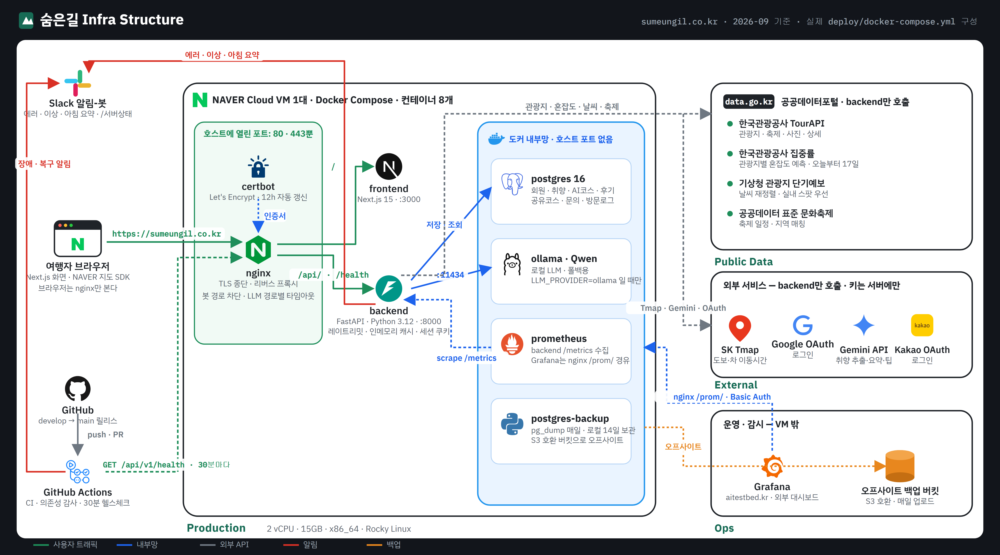
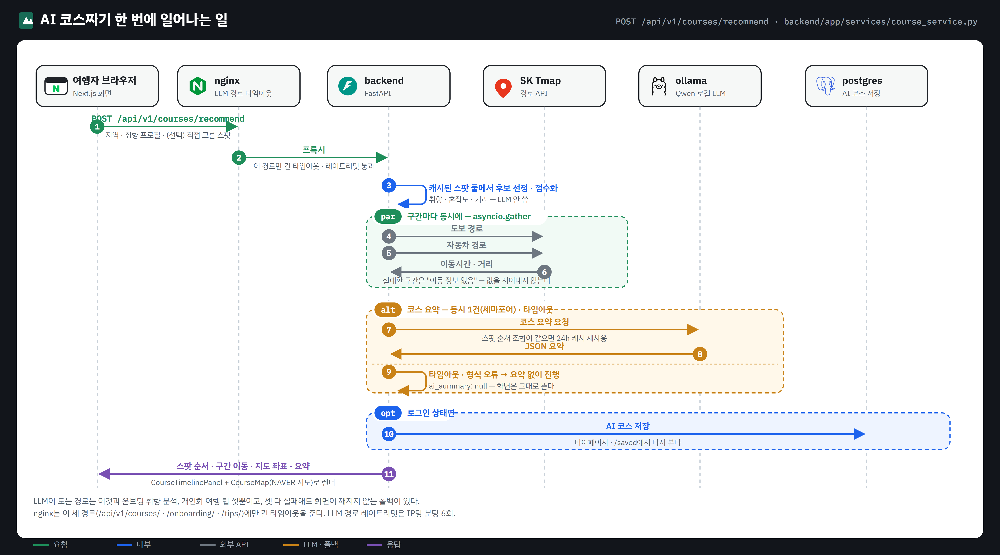

<div align="center">

# 숨은길 · Sumeungil

### 붐비는 명소 대신, 나에게 맞는 숨은 관광지를 찾는 AI 여행 서비스

[](https://sumeungil.co.kr)


실시간 혼잡도와 여행 취향을 결합해 관광지를 추천하고, 하루 코스와 이동 경로까지 한 번에 구성합니다.

</div>

## 서비스 한눈에 보기

| 취향 분석 | 숨은 관광지 추천 | AI 코스 설계 | 여행 현황 |
|:---:|:---:|:---:|:---:|
| 자연어·선택 태그에서 여행 취향 추출 | 혼잡도·취향·거리·신뢰도를 함께 반영 | 관광지 순서, 이동 시간, 지도 경로 생성 | 전국 혼잡도·날씨·축제 정보를 한 화면에 제공 |

## 아키텍처

VM 한 대(NAVER Cloud · 모두의AI실험실, 2 vCPU / 15GB)에 Docker Compose로 컨테이너 8개를 올린다.
**호스트에 열린 포트는 nginx의 80·443뿐**이고, backend·ollama·postgres는 도커 내부망에만 있다 —
ollama는 인증이 없고, backend를 직접 노출하면 레이트리밋을 우회할 수 있기 때문이다.
외부 API 키는 전부 서버(backend `.env`)에만 있고 브라우저로 나가지 않는다.



<sub>그림 원본은 [docs/architecture.svg](docs/architecture.svg), 생성 스크립트는 [docs/architecture.gen.py](docs/architecture.gen.py) — 구성이 바뀌면 스크립트를 고쳐 다시 뽑는다.</sub>

### 요청이 지나가는 길

| 화면 | 경로 | 외부 호출 | LLM |
|---|---|---|---|
| 혼잡도 전광판 · 지역 추천 | nginx → backend → 캐시(인메모리, TTL) → 없으면 TourAPI·집중률·기상청 | 공공데이터포털 | 없음 — 취향·혼잡도·거리·날씨 점수화만 |
| AI 취향 분석(온보딩) | 자유 서술 → 인젝션 가드 → ollama JSON 태그 → 실패 시 규칙 기반 폴백 → postgres 프로필 저장 | 없음 | 1회 · 로그인 필수 · 6회/분 |
| AI 코스짜기 | 스팟 선정 → Tmap 구간 이동시간 **동시 호출**(`asyncio.gather`) → ollama 코스 요약(동시 1건 세마포어, 타임아웃 시 요약 없이 응답) → 로그인 시 저장 | SK Tmap | 요약 1회 · 24h 캐시 |
| 개인화 여행 팁 | 취향·지역·날짜 키로 캐시 → 없으면 ollama → 실패 시 정적 팁 | 없음 | 조건부 · 킬스위치 |
| 로그인 | Google · Kakao OAuth 콜백 → 세션 쿠키(HttpOnly) | OAuth | 없음 |

LLM이 도는 경로는 셋뿐이고(온보딩 · 코스 요약 · 여행 팁) 모두 **실패해도 화면이 깨지지 않는 폴백**이
있다. nginx도 이 세 경로(`/api/v1/onboarding/`, `/api/v1/courses/`, `/api/v1/tips/`)만 따로 긴 타임아웃을 준다.
backend가 worker 1개인 이유는 레이트리밋과 캐시가 인메모리이기 때문이다 — 트래픽이 늘면 `cache/base.py`
인터페이스 뒤를 Redis로 바꾸고 워커를 늘린다.

### AI 코스짜기 한 번에 일어나는 일



<sub>원본 [docs/course-flow.svg](docs/course-flow.svg) · 생성 스크립트 [docs/course-flow.gen.py](docs/course-flow.gen.py)</sub>

## 기술 스택

### Frontend

<p>
  
  
  
  
  
</p>

### Backend · AI

<p>
  
  
  
  
  
</p>

### Data · Infrastructure

<p>
  
  
  
  
  
  
</p>

| 영역 | 역할 |
|---|---|
| **Next.js · React · TypeScript** | 반응형 웹 UI, 지도와 추천 결과 렌더링 |
| **FastAPI · Pydantic** | REST API, 입력 계약 검증, 추천·코스 도메인 로직 |
| **Ollama · Qwen3.5** | 외부 전송 없는 로컬 취향 추출, 요약, 개인화 여행 팁 |
| **PostgreSQL** | 회원, 취향 프로필, AI 코스, 후기와 공유 데이터 저장 |
| **TourAPI · 기상청 · 지도 API** | 관광지, 혼잡도, 날씨, 이동 경로 원천 데이터 |
| **Docker · Nginx** | 단일 VM(x86_64) 컨테이너 배포, TLS와 리버스 프록시 |
| **Prometheus · Grafana** | API 지표 수집과 운영 모니터링 |

## 로컬 실행

### 1. Backend

```bash
cd backend
pip install -r requirements.txt
cp .env.example .env   # 필요한 키는 프로젝트 관리자에게 요청
ollama pull qwen3.5:4b-q4_K_M
python -m uvicorn app.main:app --port 8000
```

### 2. Frontend

```bash
cd frontend
npm install
npm run dev
```

- Web: `http://localhost:3000`
- API 문서: `http://localhost:8000/docs`
- 로컬 LLM 비교: `cd backend && python scripts/benchmark_local_llms.py`

API 문서는 `APP_ENV`가 `production`이 아닐 때만 열립니다. 운영에서는 관리자 스키마 노출과
Swagger UI 외부 CDN 스크립트의 세션 접근 위험을 줄이기 위해 의도적으로 비활성화합니다.

## 처음 온 사람은 이 순서로

1. **[인수인계 8월 10일.md](인수인계%208월%2010일.md)** — 현재 상태, 대기 항목, 다시 밟으면 시간을 잃는 함정
2. [01-interface-contract.md](01-interface-contract.md) — 프론트엔드와 백엔드 API 계약
3. [deploy/DEPLOY.md](deploy/DEPLOY.md) — Docker, HTTPS, 운영 배포 절차
4. [APPROVALS.md](APPROVALS.md) — 결재·게이트 통과 이력
5. [STATUS.md](STATUS.md) — 기능별 구현·검수 현황
6. [docs/02-ai-strategy-현황.md](docs/02-ai-strategy-현황.md) — 로컬 AI 구조와 안전·폴백 전략

지나간 단계별 PRD·설계·QA·보안·법률 리뷰는 [docs/](docs/)에서 확인할 수 있습니다.

## 운영 원칙

- 시크릿(`.env`, API 키, 해시)은 저장소에 커밋하지 않습니다.
- 운영 배포는 대표 승인 후 진행하고 결과를 `APPROVALS.md`에 기록합니다.
- 10~12월 심사 기간에는 서버 중단 가능성이 있는 작업을 진행하지 않습니다.

## 브랜치 전략

영구 브랜치는 `main`과 `develop`입니다.

- `main` — 운영 배포 기준. 태그와 배포는 여기서만 진행합니다.
- `develop` — 평소 작업이 모이는 통합 브랜치. PR은 기본적으로 여기로 올립니다.

1. 작업 브랜치는 이슈 단위로 `develop`에서 만들고, 병합 후 삭제합니다.
2. 작업 내용을 설명하는 이슈를 만듭니다.
3. `main`·`develop`에는 직접 푸시하지 않고 PR로 병합합니다.
4. 기본 리뷰어는 대표 `@insik03`입니다. 자세한 내용은 `.github/CODEOWNERS`를 참고합니다.
5. 커밋과 PR 제목에는 아래 타입 접두어를 사용합니다.

| 접두어 | 뜻 | 대응 라벨 |
|---|---|---|
| `feat:` | 새 기능 | enhancement |
| `fix:` | 버그 수정 | bug |
| `security:` | 보안 관련 변경 | security |
| `docs:` | 문서 | documentation |
| `chore:` | 설정·잡무·리팩터링 | chore |
| `release:` | `develop → main` 배포용 머지 | release |

브랜치 이름 예시: `feat/course-map`, `fix/naver-maps-load`, `docs/readme`

## 매일 작업 시작

```bash
git checkout develop
git pull origin develop
git checkout -b feat/화면이름
```

## 저장소 접근 권한

| GitHub | 권한 |
|---|---|
| `insik03` | admin |
| `qweasd-22` | write |

팀원이 새로 필요하면 대표에게 초대를 요청합니다.

---

<div align="center">
  <sub>2026 관광데이터 활용 공모전 · 웹/앱 구현 부문 지정과제 출품작</sub>
</div>
