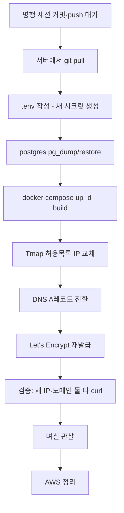

# AWS → 모두의AI실험실(NAVER Cloud) 이전

> 작성: 2026-08-20, 오케스트레이터. **읽기 전용 정찰 + 서버 준비까지 완료. 실제 서비스
> 컨테이너는 아직 옮기지 않았다 — AWS는 계속 운영 중이다.**

## 왜, 그리고 왜 지금인가

- AWS EC2 크레딧이 9월 초 소진 예정이었다(월 ~$92, 크레딧 $66).
- "모두의AI실험실" 신청이 **2026-08-20 승인**됐다.
- **리스 기간이 2026-08-20 ~ 2026-09-20, 딱 한 달이다.** 연장 가능하다고 확인은 됐지만
  (대표, 2026-08-10 기준), 연장 안 되는 경우를 대비해 **이 창 안에 실제 전환까지 끝내는
  것**이 안전하다.
- 10~12월은 심사 기간이라 **서버 정지 작업 금지** 규칙이 있다(README). 그래서 이전은
  반드시 9월 안에 끝나야 하고, 그 뒤로는 건드리지 않는 게 목표다.

## 대상 서버

| 항목 | 값 |
|---|---|
| 클라우드 | NAVER (모두의AI실험실), KR-1 |
| 외부 IP | `223.130.161.214` |
| 인스턴스ID | 144471801 / 서비스자원ID 810 |
| OS | **Rocky Linux 8.8** (커널 4.18, RHEL 계열) |
| 아키텍처 | **x86_64** |
| CPU / RAM | 2 vCPU / 15GB |
| 디스크 | 96GB 여유 (`/dev/vda2`) |
| SELinux | 비활성 |
| firewalld | 비활성 — **방화벽은 NCP 보안그룹(콘솔의 "노출포트")이 유일한 경계**다 |
| 노출 포트(콘솔 설정값) | 22, 443, 80, **3000** |
| 리스 기간 | 2026-08-20 ~ 2026-09-20 |

> ⚠️ **포트 3000이 플랫폼 레벨에서 열려 있다.** 우리 compose 구조(nginx만 호스트 80/443을
> 열고 frontend/backend는 도커 내부망)를 그대로 따르면 3000에는 아무것도 안 붙어 위험은
> 없지만, **NCP 콘솔에서 3000을 닫을 수 있는지 확인할 것** — 안 쓰는 포트는 열어둘 이유가
> 없다. `ss -tlnp` 로 실제로 뭔가 3000에서 듣고 있지 않은지 배포 후 재확인.

## AWS(Oracle Ubuntu)와 다른 점 — DEPLOY.md 그대로 따라가면 안 되는 이유

| | AWS(Oracle, 기존) | 모두의AI(NAVER, 신규) |
|---|---|---|
| OS | Ubuntu 22.04 | **Rocky Linux 8.8** |
| 아키텍처 | ARM64 (크로스빌드 제약 있었음) | **x86_64** (제약 없음) |
| 패키지 관리 | `apt` | `dnf` |
| 방화벽 | ufw + iptables 수동 설정 필요(가장 흔한 함정이었음) | **불필요** — firewalld 꺼짐, SELinux 꺼짐 |
| 서버에 git | **없음** — 매번 로컬에서 tar+scp (M-6, 미해결 과제였음) | **있음** — `git clone` 직접 가능 |
| 코드 전송 | rsync (로컬 PC → 서버) | **git clone/pull** (서버가 GitHub에서 직접) |

**git이 있다는 것 하나로 오래된 미해결 과제(M-6, "배포 마이그레이션 자동화 부재")가
사실상 해소된다.** 앞으로 코드 갱신은 서버에서 `git pull` 한 줄이면 된다.

## 지금까지 한 일 (읽기 전용 정찰 + 무해한 준비, AWS·병행 세션 영향 없음)

- [x] SSH 키 등록 — 콘솔이 준 PEM은 root 비밀번호 복호화용이었다(직접 SSH 인증키가
      아님). 비밀번호는 대표만 다뤘고(내가 다루지 않음), 대표가 1회 로그인해 내가 만든
      `naver_deploy_key`(ed25519)를 `~/.ssh/authorized_keys` 에 등록 — 이후 비밀번호 불필요.
- [x] `naver_deploy_key` / `naver_deploy_key.pub` — 저장소 루트, `.gitignore` 확인됨
      (`*_deploy_key` 패턴 추가, `naver_deploy_key`가 원래 `*.pem`에 안 걸리던 것을 발견해
      수정했다 — 이 gitignore 커밋은 아직 안 함, 다음 커밋에 포함 예정).
- [x] Docker CE 29.7.2 + Compose v5.5.0 설치, `hello-world` 실행 확인.
- [x] **GitHub 읽기전용 Deploy Key** 등록(`gh repo deploy-key add`, `naver-aitestbed-server`,
      read-only) — 로컬 `github_deploy_key`/`.pub` 생성, 프라이빗 키는 서버
      `~/.ssh/github_deploy_key` 로만 전달(터미널 출력에 남기지 않음), `~/.ssh/config` 로
      `github.com` 접속 시 이 키를 쓰도록 배선.
- [x] `git clone git@github.com:insik03/sumeungil.git /root/sumeungil` 실측 성공,
      재실행으로 재현성 확인. 현재 최신 커밋(`403a9ab`)까지 정상 반영됨.

## 아직 안 한 일 — 실제 전환 전 필요한 것

### 1. 병행 세션 작업 정리 대기 (차단 요인)

지금 로컬 저장소에 **다른 세션이 진행 중인 대규모 미커밋 변경**이 있다: 컨시어지 제거,
팁 기능 신설, 그리고 **`docker-compose.yml`·`nginx.conf`에 Prometheus+Grafana(aitestbed.kr)
연동**. 이 연동은 **모두의AI실험실 요건일 가능성이 높다**(대표 확인) — 즉 새 서버 이전에
반드시 포함해야 하는 구성일 수 있다.

→ **이 작업이 커밋되기 전에는 실제 서비스 컨테이너를 옮기지 않는다.** git clone 은 지금
당장 다시 해도 그 시점의 최신 커밋을 받아오므로, 병행 작업이 push된 뒤 서버에서
`git pull` 한 줄로 최신화하면 된다.

### 2. `.env` 작성 (서버에서, 실제 이전 시점에)

기존 `DEPLOY.md` (e)절의 키 목록은 그대로 유효하다. **바뀌는 값만:**

| 키 | 값 |
|---|---|
| `NEXT_PUBLIC_API_BASE` / `CORS_ORIGINS` / `FRONTEND_BASE_URL` | **바뀔 필요 없음** — 도메인(`sumeungil.co.kr`)을 그대로 유지하고 A레코드만 새 IP로 옮기는 것이므로 |
| `GOOGLE_REDIRECT_URI` / `KAKAO_REDIRECT_URI` | **바뀔 필요 없음**, 같은 이유(도메인 불변) |
| `POSTGRES_*` / `DATABASE_URL` | **새로 생성** — 옛 서버 값을 재사용하지 않는다(시크릿 로테이션 겸) |
| `ADMIN_SESSION_SECRET` / `USER_SESSION_SECRET` / `JWT_SECRET_KEY` | **새로 생성** — 재사용 금지 |
| `SLACK_WEBHOOK_URL` / `SLACK_SIGNING_SECRET` | 기존 값 그대로 이전 가능(같은 슬랙 워크스페이스) |

### 3. 데이터 이전 — **주의: 옛 메모리 기록이 낡았다**

과거 기록(2026-08-10)에 "sqlite 데이터 이관"이라 적혀 있는데, **그 이후(2026-08-17)
PostgreSQL로 전환됐다.** 실제로는:

```bash
# AWS 서버에서 — 정합성 있는 덤프
docker compose exec postgres pg_dump -U <POSTGRES_USER> <POSTGRES_DB> > sumeungil_dump.sql
# 새 서버로 전송 (git 이 되니 scp 도 당연히 된다)
scp -i naver_deploy_key sumeungil_dump.sql root@223.130.161.214:/root/
# 새 서버에서 — postgres 컨테이너 기동 후
docker compose exec -T postgres psql -U <POSTGRES_USER> <POSTGRES_DB> < /root/sumeungil_dump.sql
```

실사용자 데이터(리뷰·공유코스·계정·방문통계)가 걸려 있으므로 **덤프 전후 행 수를 대조
할 것** — `SELECT count(*) FROM reviews` 등. 무손실 이관은 지난 SQLite→Postgres 전환 때도
핵심 원칙이었다(작업일지 참고).

### 4. Tmap 허용목록 IP 교체

Tmap 콘솔에서 도메인/IP 제한을 새 IP(`223.130.161.214`)로 바꿔야 지도가 뜬다. 옛 IP는
전환 확인 후 제거(전환 중 롤백 여유를 위해 즉시 지우지 않는다).

### 5. DNS A레코드 전환 + Let's Encrypt 재발급

```
sumeungil.co.kr  A  223.130.161.214   (기존 54.116.76.172 에서 교체)
```

TTL이 짧다면(이전에 짧게 설정해뒀는지 확인) 전파를 기다린 뒤, 새 서버에서 certbot으로
인증서를 새로 발급받는다(기존 인증서는 옛 IP 기준이라 재사용 불가). 절차는 `DEPLOY.md`
"HTTPS" 절 그대로.

### 6. 검증 후 AWS 정리

새 서버가 완전히 정상 동작 확인된 뒤에만 AWS 인스턴스를 정지/종료한다. **최소 며칠은
AWS를 살려두고 새 서버가 실트래픽을 받는 걸 지켜본 뒤 정리하는 게 안전하다.**

## 순서 요약



## 롤백

DNS A레코드를 옛 IP로 되돌리면 즉시 롤백된다(TTL만큼 전파 시간 소요). AWS를 최소 며칠
살려두는 이유가 이것이다. Postgres 데이터는 AWS 쪽에 원본이 그대로 남아있으므로 롤백해도
데이터 손실이 없다(새 서버 쪽에 그 사이 쌓인 신규 데이터가 있다면 그것만 유실 위험 —
그래서 관찰 기간은 짧게 잡는다).
