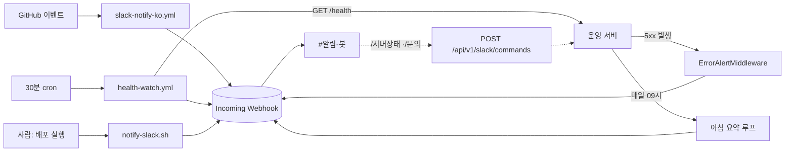

# 슬랙 알림 설정 (#서버-알림 · #깃허브-알림)

숨은팀 슬랙의 `#알림-봇` 채널을 쓰는 알림·봇 기능 6종의 구조와 설정 절차. (2026-08-18 신설)

> **`#알림-봇` 은 자동 알림 전용이다.** 사람 대화는 `#개발` 에서 한다.

## 전체 목록

| 알림 | 무엇을 알리나 | 어디서 도나 | 감지 속도 |
|---|---|---|---|
| **한국어 GitHub 알림** | main 커밋 / PR 열림·머지 / 이슈 등록·닫힘 / 릴리스 | GitHub Actions `slack-notify-ko.yml` | 즉시 |
| **서버 상태 감시** | 사이트 응답 없음, 헬스체크 degraded, 복구 | GitHub Actions `health-watch.yml` (30분마다) | 최대 30분 |
| **5xx 에러 알림** | 500 응답·미처리 예외 + `Location: 파일 Line N` | 운영 서버 FastAPI 미들웨어 | 즉시 |
| **아침 운영 요약** | 어제 방문·처리 대기·누적·서버 상태 | 운영 서버 백그라운드 루프 | 매일 09:00 KST |
| **배포 알림** | 배포 시작/완료/실패 + 실행자 | `deploy/notify-slack.sh` (사람이 실행) | 즉시 |
| **`/서버상태` ·`/문의`** | 물어보면 답하는 조회 | 운영 서버 `/api/v1/slack/commands` | 즉시 |



**보내는 5개 경로가 같은 웹훅 URL 하나를 공유한다.** 그래서 발급은 1회면 되고, 넣는 곳은
두 군데다(GitHub Secrets + 운영 서버 `.env`).

슬래시 명령어만 방향이 반대다 — 슬랙이 **우리 서버를 호출**하므로 웹훅이 아니라
별도의 `SLACK_SIGNING_SECRET` 이 필요하다(아래 "봇 기능" 절).

---

## 채널 분리 (2026-09-03, 대표 지시)

알림이 `#알림-봇` 하나에 다 섞여서 서버 상태와 PR·이슈를 구분하기 어렵다는 피드백으로 두 채널로 나눈다.

| 채널 | 무엇이 오나 | 보내는 쪽 | 웹훅 시크릿/변수 |
|---|---|---|---|
| `#서버-알림` (기존 `#알림-봇` 이름만 바꿔도 됨) | 서버 다운/복구(30분 헬스체크), 5xx·이상행동 알림, 아침 운영 요약, `/서버상태`, main 푸시·릴리스(=배포) | health-watch.yml · backend 미들웨어 · slack-notify-ko.yml(push/release) | `SLACK_WEBHOOK_URL` (GitHub Secrets + 서버 `.env`, 기존 그대로) |
| `#깃허브-알림` (신규) | PR 열림/머지/닫힘, 이슈 열림/닫힘 | slack-notify-ko.yml(pull_request/issues) | `SLACK_WEBHOOK_GITHUB` (GitHub Secrets 만) |

설정 순서:
1. 슬랙에서 `#깃허브-알림` 채널을 만든다.
2. 아래 1단계와 같은 방법으로 **그 채널용 웹훅을 하나 더** 발급한다(웹훅은 채널에 묶인다).
3. GitHub → Settings → Secrets → Actions 에 `SLACK_WEBHOOK_GITHUB` 로 등록한다.
4. 끝. 서버 `.env` 는 건드릴 것 없다(backend 는 서버 채널만 쓴다). `SLACK_WEBHOOK_GITHUB` 가 없으면 예전처럼 전부 서버 채널로 간다.

에러 알림은 이미 있다 — backend 의 5xx 알림 미들웨어(아래 3단계)가 켜져 있으면 5xx 가 날 때마다, 이상행동 탐지가 걸릴 때마다 `#서버-알림` 으로 온다. 스택트레이스까지 보고 싶으면 Sentry 무료 티어를 붙이는 게 다음 단계지, Datadog 은 VM 1대 규모엔 과하다(호스트당 월 $15~ + APM 별도, 이미 Prometheus·Grafana 가 지표를 본다).

## 1단계 — 슬랙 웹훅 발급 (1회)

1. <https://api.slack.com/apps> → **Create New App** → **From scratch**
2. 이름 `숨은 알림봇`, 워크스페이스 **숨은** 선택 → Create App
3. 왼쪽 메뉴 **Incoming Webhooks** → 토글을 **On**
4. 맨 아래 **Add New Webhook to Workspace** → 채널 **#알림-봇** 선택 → **허용**
5. 생성된 `https://hooks.slack.com/services/...` 를 **Copy**

> ⚠️ **이 URL 은 비밀번호와 같다.** 아는 사람은 누구나 우리 채널에 아무 글이나 쓸 수 있다.
> 커밋 금지, 슬랙 메시지·이슈에 붙여넣기 금지. 유출되면 3단계를 다시 해서 새로 발급하고
> 옛 웹훅은 슬랙 앱 설정에서 삭제한다.

## 2단계 — GitHub Secrets 에 등록

저장소 → **Settings → Secrets and variables → Actions → New repository secret**

| Name | Value |
|---|---|
| `SLACK_WEBHOOK_URL` | 1단계에서 복사한 URL |

이름이 정확히 `SLACK_WEBHOOK_URL` 이어야 한다. **없으면 워크플로가 조용히 건너뛴다**
(실패로 뜨지 않으니, 알림이 안 오면 여기부터 확인할 것 — 각 실행의 Summary 에 이유가 찍힌다).

## 3단계 — 운영 서버 `.env` 에 등록 (5xx 알림용)

이 작업은 **운영 서버(EC2) 안에서** 한다. 대표 PC 에서 하는 게 아니다.
편집할 파일은 `backend/.env` 가 **아니라** `/home/ubuntu/sumeungil/deploy/.env` 다
(docker-compose 가 `env_file: .env` 로 backend 컨테이너에 넘기는 그 파일).

```bash
# 1) 개발 PC 에서 서버 접속 (키는 대표 로컬에만 있음, git 에 없음)
ssh -i "<Sumeun.pem 경로>" ubuntu@<VM_PUBLIC_IP>

# 2) 서버에서 .env 편집 — 맨 아래에 한 줄 추가
nano /home/ubuntu/sumeungil/deploy/.env
#    SLACK_WEBHOOK_URL=https://hooks.slack.com/services/...
#    (Ctrl+O → Enter 저장, Ctrl+X 종료)

# 3) 반영 — restart 가 아니라 up -d 다
cd /home/ubuntu/sumeungil/deploy && docker compose up -d backend

# 4) 켜졌는지 확인 — "등록 완료" 가 보이면 성공, "미등록" 이면 실패
docker compose logs backend | grep -iE "슬랙" | tail -5
```

로그가 **비어 있으면 판단하지 말 것**. 등록 로그는 부팅 시점에 한 번만 찍히므로
`--tail` 범위 밖으로 밀려나면 켜졌어도 아무것도 안 나온다. 그때는 컨테이너 환경변수를
직접 본다 — 값은 안 나오고 유무만 알려준다:

```bash
docker compose exec backend sh -c '[ -n "$SLACK_WEBHOOK_URL" ] && echo "설정됨(켜짐)" || echo "없음(꺼짐)"'
```

> ⚠️ **`docker compose restart backend` 는 안 된다.** restart 는 같은 컨테이너를 껐다
> 켜기만 해서 `env_file` 을 다시 읽지 않는다 — 넣었는데 안 켜진 것처럼 보인다.
> `up -d` 만 설정 변경을 감지해 컨테이너를 새로 만든다.
>
> `--build` 도 필요 없다. 코드가 아니라 환경변수만 바뀌었기 때문이다(빌드는 몇 분 더 걸린다).

`SLACK_WEBHOOK_URL` 이 비어 있으면 미들웨어를 **아예 등록하지 않는다** — 로컬 개발에서
쓸데없이 슬랙을 두드리지 않게 한 의도적 기본값이다. 부팅 로그에서 확인:

```
슬랙 5xx 알림 미등록(SLACK_WEBHOOK_URL 미설정) — 로컬 개발 기본값   ← 꺼진 상태
```

새로 서버를 세팅하는 경우엔 `backend/.env.production.example` 에 이 키가 이미 들어 있으므로
(e) 단계에서 함께 채우면 된다.

> **운영 배포는 대표 승인 후에만.** 10~12월 심사 기간에는 서버 정지 작업 금지
> (README 규칙). 3단계는 배포가 필요하므로 1·2단계만 먼저 해도 GitHub 알림 2종은 돈다.

---

## 하지 말 것: `/github subscribe`

슬랙에서 `/github subscribe insik03/sumeungil` 를 실행하면 **같은 사건이 영어로 한 번 더**
온다. GitHub 공식 Slack 앱은 알림 문구가 영어 고정이고(마켓플레이스 지원 언어: 영어)
한국어로 바꿀 설정이 없어서 우리는 Actions 로 직접 한국어 문구를 만든다.

공식 앱은 **설치만** 해 두면 링크 미리보기와 `/github` 명령이 되니 그대로 두면 된다.

## GitHub Actions 무료 분수 (주기를 바꾸기 전에)

이 저장소는 **비공개**라 Actions 사용량이 계정 무료 한도(월 2,000분)에서 차감되고,
잡 하나는 **1분 단위로 올림 청구**된다(20초 걸려도 1분).

| health-watch 주기 | 월 실행 횟수 | 최소 청구 | 판정 |
|---|---|---|---|
| 5분 | 8,640 | 8,640분 | ❌ 한도 4배 초과 |
| 10분 | 4,320 | 4,320분 | ❌ 초과 |
| **30분 (현재)** | 1,440 | 1,440분 | ✅ 약 560분 여유 |

**1~5분 간격 감시가 필요하면 cron 을 줄이지 말고 외부 무료 업타임 모니터를 쓸 것**
(UptimeRobot 무료 플랜 = 모니터 50개·5분 간격·슬랙 연동 내장, GitHub 분수 소모 0).
그쪽을 붙이면 `health-watch.yml` 은 꺼도 된다.

## 알아둘 제약

- GitHub `schedule` 은 정시 보장이 아니다 — 혼잡하면 수분~십수분 지연되고 드물게 건너뛴다.
- **저장소에 60일간 활동이 없으면 스케줄 워크플로가 자동 비활성화된다.** 심사 기간에 커밋이
  끊기면 감시도 멈춘다 → Actions 탭에서 켜져 있는지 확인할 것.
- 서버 상태 알림은 **상태가 바뀔 때만** 온다(정상→이상, 이상→복구). 6시간 죽어 있어도
  알림은 1건이다. 지금 상태를 보려면 Actions → 서버 상태 감시 → **Run workflow** 로 수동 실행.
- 5xx 알림은 같은 `(경로, 예외)` 조합을 10분에 1회만 보낸다
  (`SLACK_ALERT_DEDUP_WINDOW_SEC` 으로 조절).

## 시크릿이 알림에 실리지 않는 이유

`ErrorAlertMiddleware` 는 **경로만** 보내고 쿼리스트링을 버린다. 공공데이터 URL 은
쿼리에 `serviceKey`(=`PUBLIC_DATA_API_KEY`)를 담기 때문이다 — `app/main.py` 가 httpx 로거를
WARNING 으로 올려 둔 것과 같은 이유다. 게다가 httpx 예외는 **메시지 안에** 요청 URL 을
통째로 넣으므로, 예외 메시지와 트레이스백도 `serviceKey`·`token`·`secret` 류 값을
`***` 로 치환한 뒤 보낸다.

검증 스크립트가 이걸 실제로 확인한다 (배포 전 필수):

```bash
cd backend
.venv/Scripts/python.exe scripts/verify_error_alert.py   # Windows
```

## 문제가 생기면

| 증상 | 확인할 것 |
|---|---|
| 알림이 하나도 안 온다 | **먼저 연결 테스트**(바로 아래) 를 돌린다. 그것도 안 오면 GitHub Secrets 에 `SLACK_WEBHOOK_URL` 이 있는지 확인 — 없으면 Actions 실행의 Summary 에 "시크릿이 없어 건너뜁니다" 가 찍힌다 |
| GitHub 알림이 영어로 중복 | 슬랙에서 `/github unsubscribe insik03/sumeungil` |
| 서버 알림이 안 온다 | Actions 탭에서 **서버 상태 감시** 가 비활성화됐는지(60일 규칙). Run workflow 로 수동 실행해 볼 것 |
| 5xx 알림만 안 온다 | 운영 서버 `.env` 의 `SLACK_WEBHOOK_URL` + 재시작 여부. 부팅 로그에 "미등록" 이 찍혔는지 |
| 슬랙이 알림으로 잠긴다 | `SLACK_ALERT_DEDUP_WINDOW_SEC` 을 늘린다(기본 600초) |

## 연결 테스트 (알림이 안 올 때 제일 먼저)

저장소 **Actions** 탭 → 왼쪽 **슬랙 한국어 알림** → 오른쪽 **Run workflow** → 초록 버튼.
`#알림-봇` 에 아래 한 줄이 오면 웹훅·시크릿은 정상이다(문제는 다른 곳에 있다).

> 🔔 **알림 연결 테스트** — insik03/sumeungil
> 이 메시지가 보이면 웹훅과 시크릿이 정상입니다. (실행: insik03)

커밋을 만들지 않고 확인할 수 있으므로 팀원 누구나 눌러도 된다.

## 최초 가동 확인 기록 (2026-08-18)

| 항목 | 결과 |
|---|---|
| 한국어 push 알림 | ✅ 실측 도착 (`6062587` 커밋 알림) |
| 수동 연결 테스트 | ✅ 실측 도착 |
| 서버 상태 감시 | ✅ 30분 cron 정상 실행, `status: ok` 판정 |
| 5xx 알림 미들웨어 | ✅ 운영 배포 완료 — 컨테이너 환경변수 확인으로 켜짐 검증 |

> 같은 날 14:30 실제 장애(`upstream_kto=fail`, 관광공사 원천 일시 실패)가 발생해
> degraded 알림 → 14:59 자동 복구 알림까지 실증됐다. 서버 자체는 정상이었다.
> 이 원천은 무료 외부 API 라 종종 흔들린다.
>
> **2026-08-26(대표 지시) — 알림을 끄는 대신 원인·조치필요 여부를 알림에 그대로 실었다.**
> "그냥 성능 저하"만 오면 매번 서버가 진짜 문제인지 구분이 안 된다는 지적 — `upstream_kto=fail`
> 은 위 실측처럼 흔한 외부 원인이라 꺼버릴 수도 있었지만, 대신 알림 자체를 더 친절하게
> 만들었다. `health-watch.yml`이 원인별로 사람이 읽을 문장(공공데이터 실패=외부 원인·자동
> 복구·"대표님 할 일 없음" vs 캐시/서버다운=우리 쪽 문제·"제가 확인" )을 붙여 보내고,
> 복구 알림에도 직전 장애 실행의 판정 로그를 다시 읽어와 "직전 문제: ..."로 같이 보낸다.

---

# 봇 기능 (2026-08-18 추가)

앞의 3종이 "봇이 먼저 말하는" 알림이라면, 아래는 **묻고 답하는 기능**과 **정기 브리핑**이다.
BCSDLab 삐봇을 참고했지만 그쪽 명령어(`/강의공지`·`/동방`)는 동아리 전용이라 가져오지 않았다.

## 아침 운영 요약 — 추가 설정 없음

`SLACK_WEBHOOK_URL` 만 있으면 돈다. 매일 `SLACK_DAILY_SUMMARY_HOUR`(기본 9시, KST)에
`#알림-봇` 으로 이런 한 묶음이 온다.

```
📋 숨은길 아침 브리핑 — 2026-08-19 (수)
· 어제(08-18) 방문자 12명(추정) · 조회 143회
· 처리 대기: 미답변 문의 2건
· 누적: 후기 34건 · 공유코스 12건 · 문의 15건
🟢 서버 ok — 공공데이터 ok · 캐시 ok
```

**배포할 때는 오지 않는다.** 부팅 직후 발송하지 않고 다음 지정 시각까지 기다리게 만들었다 —
안 그러면 재배포마다 브리핑이 와서 소음이 된다. 끄려면 `SLACK_DAILY_SUMMARY_HOUR=-1`.

## 배포 알림 — 배포 절차에 두 줄 추가

서버에 git 이 없어 배포가 수동(tar+scp)이라, 팀원은 누가 언제 배포했는지 알 수 없었다.
사이트가 잠깐 끊기면 장애부터 의심하게 된다. 배포 앞뒤로 이렇게 부른다:

```bash
cd /home/ubuntu/sumeungil/deploy
./notify-slack.sh start "관리자 콘솔 문의 탭 추가"
docker compose up -d --build backend
./notify-slack.sh done  "관리자 콘솔 문의 탭 추가"    # 실패했으면 fail
```

웹훅 URL 은 **인자로 받지 않는다** — 셸 히스토리에 시크릿이 남기 때문이다. 같은 폴더의
`.env` 에서 읽는다. 알림이 실패해도 스크립트는 `exit 0` 이다(알림 때문에 배포가 멈추면 안 된다).

## 슬래시 명령어 — 설정이 필요하다

| 명령어 | 하는 일 | 별칭 |
|---|---|---|
| `/서버상태` | 종합 상태 + 공공데이터·캐시 + 오늘 방문 집계 | `/status` `/서버` |
| `/문의` | 미답변 고객문의 건수 / 누적 | `/inquiries` |

응답은 **ephemeral** — 명령을 실행한 사람에게만 보인다. 운영 수치가 90일 히스토리에 쌓이지
않게, 그리고 3명 채널이 조회 결과로 도배되지 않게 한 선택이다.

### 설정 절차

1. <https://api.slack.com/apps> → **Sumeungil Alerts** → **Slash Commands** → *Create New Command*

   | 항목 | 값 |
   |---|---|
   | Command | `/서버상태` |
   | Request URL | `https://sumeungil.co.kr/api/v1/slack/commands` |
   | Short Description | 서버 상태와 오늘 방문 집계 |

   `/문의` 도 같은 Request URL 로 하나 더 만든다. **URL 은 둘이 같다** — 서버가 `command`
   값을 보고 갈라준다.

2. **Basic Information → App Credentials → Signing Secret** 을 복사해 운영 `.env` 에 넣는다.

   ```bash
   nano /home/ubuntu/sumeungil/deploy/.env
   #   SLACK_SIGNING_SECRET=...
   cd /home/ubuntu/sumeungil/deploy && docker compose up -d backend
   ```

3. 슬랙에서 `/서버상태` 를 쳐 본다. 부팅 로그로도 확인된다:

   ```
   슬랙 슬래시 명령어 등록 완료 (/api/v1/slack/commands)
   ```

### 이 엔드포인트가 안전한 이유

슬랙이 호출하므로 인증 쿠키를 쓸 수 없다 — **요청 서명 검증이 유일한 방어선**이다.

- `HMAC-SHA256(signing_secret, "v0:타임스탬프:원본본문")` 을 `X-Slack-Signature` 와
  **상수시간 비교**한다(`==` 로 비교하면 응답 시간 차이로 서명을 알아낼 수 있다)
- 타임스탬프가 5분보다 오래되면 서명이 유효해도 거부 — **재전송 공격** 방어
- 검증은 **원본 바이트**로 한다. 파싱한 폼을 재직렬화하면 서명이 깨진다
- `SLACK_SIGNING_SECRET` 이 비면 라우터를 **등록조차 하지 않는다**(404, fail-closed)
- 응답에 **관리자 콘솔 경로를 넣지 않는다** — 경로를 비밀로 둔 결정(2026-08-17)을 지킨다

배포 전 필수 검증 (8개 시나리오 · 15개 항목):

```bash
cd backend
.venv/Scripts/python.exe scripts/verify_slack_commands.py   # Windows
```

정상 서명·서명 없음·서명 위조·재전송·본문 개조·키 미설정·모르는 명령어·관리자 경로 유출을
전부 검사한다.
