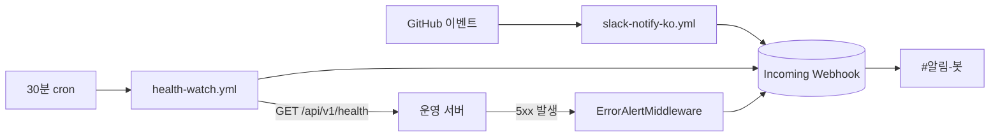

# 슬랙 알림 설정 (#알림-봇)

숨은팀 슬랙의 `#알림-봇` 채널로 오는 알림 3종의 구조와 설정 절차. (2026-08-18 신설)

> **`#알림-봇` 은 자동 알림 전용이다.** 사람 대화는 `#개발` 에서 한다.

## 알림 3종

| 알림 | 무엇을 알리나 | 어디서 도나 | 감지 속도 |
|---|---|---|---|
| **한국어 GitHub 알림** | main 커밋 / PR 열림·머지 / 이슈 등록·닫힘 / 릴리스 | GitHub Actions `slack-notify-ko.yml` | 즉시 |
| **서버 상태 감시** | 사이트 응답 없음, 헬스체크 degraded, 복구 | GitHub Actions `health-watch.yml` (30분마다) | 최대 30분 |
| **5xx 에러 알림** | 500 응답·미처리 예외 + 경로·예외·트레이스백 | 운영 서버 FastAPI 미들웨어 | 즉시 |



세 경로가 **같은 웹훅 URL 하나**를 공유한다. 그래서 발급은 1회면 되고, 넣는 곳은 두 군데다
(GitHub Secrets + 운영 서버 `.env`).

---

## 1단계 — 슬랙 웹훅 발급 (1회)

1. <https://api.slack.com/apps> → **Create New App** → **From scratch**
2. 이름 `숨은 알림봇`, 워크스페이스 **숨은** 선택 → Create App
3. 왼쪽 메뉴 **Incoming Webhooks** → 토글을 **On**
4. 맨 아래 **Add New Webhook to Workspace** → 채널 **#알림-봇** 선택 → **허용**
5. 생성된 `https://hooks.slack.com/services/...` 를 **Copy**

> ⚠️ **이 URL 은 비밀번호와 같다.** 아는 사람은 누구나 우리 채널에 아무 글이나 쓸 수 있다.
> 커밋 금지, 슬랙 메시지·이슈에 붙여넣기 금지. 유출되면 3단계를 다시 해서 새로 발급하고
> 옛 웹훅은 슬랙 앱 설정에서 삭제한다.

## 2단계 — GitHub Secrets 에 등록

저장소 → **Settings → Secrets and variables → Actions → New repository secret**

| Name | Value |
|---|---|
| `SLACK_WEBHOOK_URL` | 1단계에서 복사한 URL |

이름이 정확히 `SLACK_WEBHOOK_URL` 이어야 한다. **없으면 워크플로가 조용히 건너뛴다**
(실패로 뜨지 않으니, 알림이 안 오면 여기부터 확인할 것 — 각 실행의 Summary 에 이유가 찍힌다).

## 3단계 — 운영 서버 `.env` 에 등록 (5xx 알림용)

```bash
# 운영 서버에서
echo 'SLACK_WEBHOOK_URL=https://hooks.slack.com/services/...' >> backend/.env
# 재시작해야 적용된다 (미들웨어는 부팅 시점에 등록 여부가 결정된다)
docker compose up -d --build backend
```

`SLACK_WEBHOOK_URL` 이 비어 있으면 미들웨어를 **아예 등록하지 않는다** — 로컬 개발에서
쓸데없이 슬랙을 두드리지 않게 한 의도적 기본값이다. 부팅 로그에서 확인:

```
슬랙 5xx 알림 미등록(SLACK_WEBHOOK_URL 미설정) — 로컬 개발 기본값   ← 꺼진 상태
```

> **운영 배포는 대표 승인 후에만.** 10~12월 심사 기간에는 서버 정지 작업 금지
> (README 규칙). 3단계는 배포가 필요하므로 1·2단계만 먼저 해도 GitHub 알림 2종은 돈다.

---

## 하지 말 것: `/github subscribe`

슬랙에서 `/github subscribe insik03/sumeungil` 를 실행하면 **같은 사건이 영어로 한 번 더**
온다. GitHub 공식 Slack 앱은 알림 문구가 영어 고정이고(마켓플레이스 지원 언어: 영어)
한국어로 바꿀 설정이 없어서 우리는 Actions 로 직접 한국어 문구를 만든다.

공식 앱은 **설치만** 해 두면 링크 미리보기와 `/github` 명령이 되니 그대로 두면 된다.

## GitHub Actions 무료 분수 (주기를 바꾸기 전에)

이 저장소는 **비공개**라 Actions 사용량이 계정 무료 한도(월 2,000분)에서 차감되고,
잡 하나는 **1분 단위로 올림 청구**된다(20초 걸려도 1분).

| health-watch 주기 | 월 실행 횟수 | 최소 청구 | 판정 |
|---|---|---|---|
| 5분 | 8,640 | 8,640분 | ❌ 한도 4배 초과 |
| 10분 | 4,320 | 4,320분 | ❌ 초과 |
| **30분 (현재)** | 1,440 | 1,440분 | ✅ 약 560분 여유 |

**1~5분 간격 감시가 필요하면 cron 을 줄이지 말고 외부 무료 업타임 모니터를 쓸 것**
(UptimeRobot 무료 플랜 = 모니터 50개·5분 간격·슬랙 연동 내장, GitHub 분수 소모 0).
그쪽을 붙이면 `health-watch.yml` 은 꺼도 된다.

## 알아둘 제약

- GitHub `schedule` 은 정시 보장이 아니다 — 혼잡하면 수분~십수분 지연되고 드물게 건너뛴다.
- **저장소에 60일간 활동이 없으면 스케줄 워크플로가 자동 비활성화된다.** 심사 기간에 커밋이
  끊기면 감시도 멈춘다 → Actions 탭에서 켜져 있는지 확인할 것.
- 서버 상태 알림은 **상태가 바뀔 때만** 온다(정상→이상, 이상→복구). 6시간 죽어 있어도
  알림은 1건이다. 지금 상태를 보려면 Actions → 서버 상태 감시 → **Run workflow** 로 수동 실행.
- 5xx 알림은 같은 `(경로, 예외)` 조합을 10분에 1회만 보낸다
  (`SLACK_ALERT_DEDUP_WINDOW_SEC` 으로 조절).

## 시크릿이 알림에 실리지 않는 이유

`ErrorAlertMiddleware` 는 **경로만** 보내고 쿼리스트링을 버린다. 공공데이터 URL 은
쿼리에 `serviceKey`(=`PUBLIC_DATA_API_KEY`)를 담기 때문이다 — `app/main.py` 가 httpx 로거를
WARNING 으로 올려 둔 것과 같은 이유다. 게다가 httpx 예외는 **메시지 안에** 요청 URL 을
통째로 넣으므로, 예외 메시지와 트레이스백도 `serviceKey`·`token`·`secret` 류 값을
`***` 로 치환한 뒤 보낸다.

검증 스크립트가 이걸 실제로 확인한다 (배포 전 필수):

```bash
cd backend
.venv/Scripts/python.exe scripts/verify_error_alert.py   # Windows
```

## 문제가 생기면

| 증상 | 확인할 것 |
|---|---|
| 알림이 하나도 안 온다 | **먼저 연결 테스트**(바로 아래) 를 돌린다. 그것도 안 오면 GitHub Secrets 에 `SLACK_WEBHOOK_URL` 이 있는지 확인 — 없으면 Actions 실행의 Summary 에 "시크릿이 없어 건너뜁니다" 가 찍힌다 |
| GitHub 알림이 영어로 중복 | 슬랙에서 `/github unsubscribe insik03/sumeungil` |
| 서버 알림이 안 온다 | Actions 탭에서 **서버 상태 감시** 가 비활성화됐는지(60일 규칙). Run workflow 로 수동 실행해 볼 것 |
| 5xx 알림만 안 온다 | 운영 서버 `.env` 의 `SLACK_WEBHOOK_URL` + 재시작 여부. 부팅 로그에 "미등록" 이 찍혔는지 |
| 슬랙이 알림으로 잠긴다 | `SLACK_ALERT_DEDUP_WINDOW_SEC` 을 늘린다(기본 600초) |

## 연결 테스트 (알림이 안 올 때 제일 먼저)

저장소 **Actions** 탭 → 왼쪽 **슬랙 한국어 알림** → 오른쪽 **Run workflow** → 초록 버튼.
`#알림-봇` 에 아래 한 줄이 오면 웹훅·시크릿은 정상이다(문제는 다른 곳에 있다).

> 🔔 **알림 연결 테스트** — insik03/sumeungil
> 이 메시지가 보이면 웹훅과 시크릿이 정상입니다. (실행: insik03)

커밋을 만들지 않고 확인할 수 있으므로 팀원 누구나 눌러도 된다.

## 최초 가동 확인 기록 (2026-08-18)

| 항목 | 결과 |
|---|---|
| 한국어 push 알림 | ✅ 실측 도착 (`6062587` 커밋 알림) |
| 수동 연결 테스트 | ✅ 실측 도착 |
| 서버 상태 감시 | ✅ 30분 cron 정상 실행, `status: ok` 판정 |
| 5xx 알림 미들웨어 | ⏸️ 코드·검증 완료, **운영 배포 승인 대기** (3단계 미실시) |
